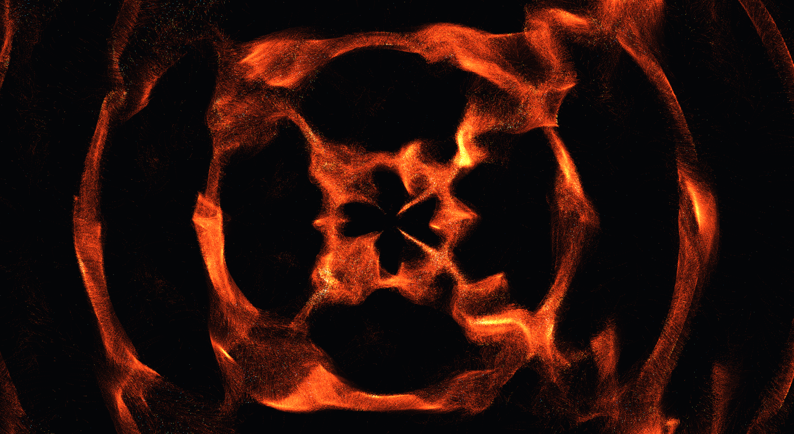

# Chladni Plate Audio Visualizer

Real-time GPU-accelerated Chladni plate cymatics visualizer written in Rust using `wgpu`, `eframe`/`egui`, `cpal`, and `rustfft`. Acoustic energy drives standing-wave nodal patterns across up to **1,000,000 particles** simulated completely in WGSL compute shaders with additive glow and ping-pong motion trails.

## Screenshot

> 

## Features

- **GPU Compute Physics (`wgpu` WGSL):** Gradient descent (`-∇w²`), iso-contour curl/swirl, Brownian thermal agitation, and bass-transient scattering executed in `@compute @workgroup_size(256)`.
- **Ping-Pong Motion Trails & Additive Bloom:** Offscreen `Rgba16Float` ping-pong targets with configurable trail persistence and highlight rolloff.
- **Tri-Band Spectral Superposition & Sliding-Window FFT:** Continuous Hann-windowed FFT with bass-weighted perceptual tilt, sub-bin peak interpolation, asymmetric attack/release envelope tracking, and low-frequency (`25–400 Hz`) beat-kick scatter detection.
- **Plate Geometries & Solvers:** Square, Circular, and Hexagonal plates with Classic Symmetric, Asymmetric Mixed, and Bessel Circular solvers, plus **Use Screen as Borders** full-viewport scaling.
- **Audio Sources & Built-in Synth:** System audio loopback, microphone input, or the built-in sine/sweep test-tone generator.
- **Scalable Particle Budget & Persistent Presets:** `250,000` default particle slider cap with a warning-gated unlock up to `1,000,000` particles; custom presets save to and load from your OS config directory.

## Controls & Shortcuts

| Action | Input |
| :--- | :--- |
| Toggle true fullscreen | `F11`, sidebar **Fullscreen** button, or maximize |
| Exit fullscreen | `Esc`, `F11`, or top-right `✕` overlay button |
| Open/collapse settings in fullscreen | Top-left `⚙` button |
| Expand/collapse settings panel | Sidebar **Collapse** / **Open Settings** button |
| Unlock `1,000,000` particle cap | **Visuals & Shader Tweaks** → **Unlock 1,000,000 Particle Cap** |
| Save / apply / delete presets | **Presets** section in the settings sidebar |

## Prerequisites

- **Rust toolchain** (stable `1.80+`, Edition `2021`) via [rustup](https://rustup.rs/).
- A GPU and driver supporting **DirectX 12** (Windows), **Vulkan** (Windows/Linux), or **Metal** (macOS).
- **Platform notes:**
  - **Windows:** Uses `wgpu` DirectX 12 by default (override via `WGPU_BACKEND`) and WASAPI loopback/input audio.
  - **Linux:** Install ALSA development headers (`libasound2-dev` on Debian/Ubuntu) plus Vulkan/Wayland/X11 system libraries required by `cpal` and `winit`.
  - **macOS:** Uses Metal and CoreAudio out of the box (system output loopback requires a virtual audio routing driver such as BlackHole; Microphone and Internal Synth work directly).

## Build, Run & Test

```bash
# Build and launch in release mode (recommended for smooth frame pacing)
cargo run --release

# Run unit tests & WGSL compute/render pipeline validation
cargo test --release

# Run strict linter checks
cargo clippy --all-targets -- -D warnings
```

Preset configurations are stored automatically in:
- **Windows:** `%APPDATA%\ChladniVisualizer\presets.json`
- **Linux:** `$XDG_CONFIG_HOME/chladni-visualizer/presets.json` or `~/.config/chladni-visualizer/presets.json`
- **macOS:** `~/Library/Application Support/ChladniVisualizer/presets.json`

## License

Licensed under the [MIT License](LICENSE).
